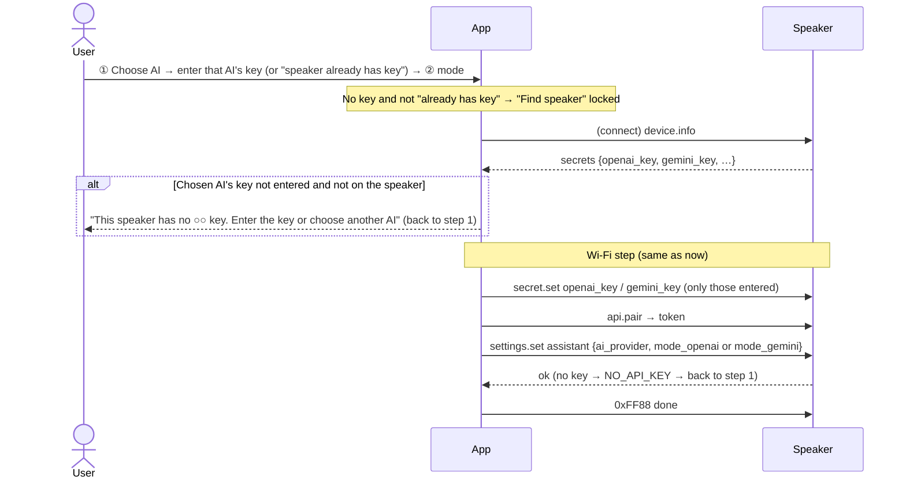
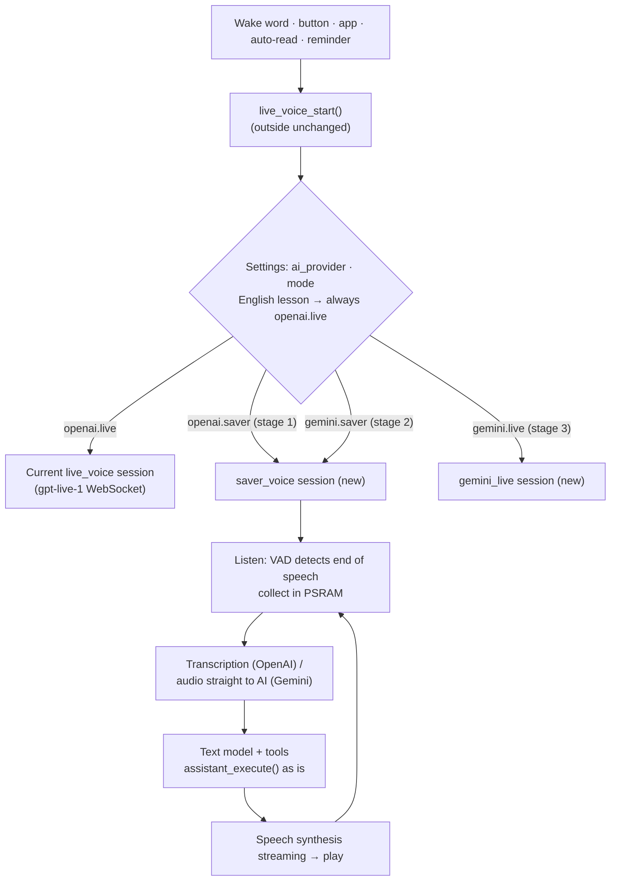
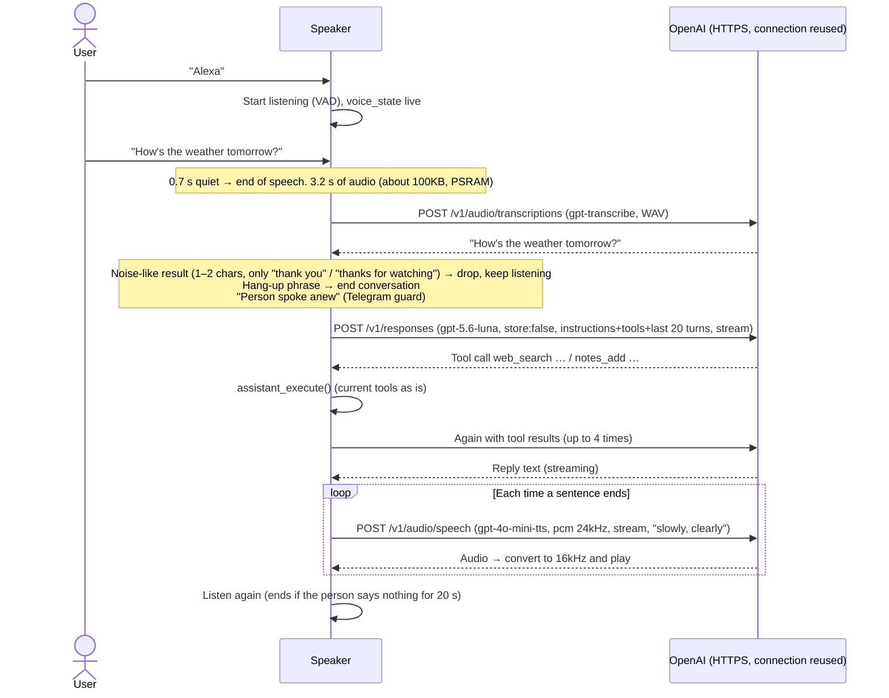

# Design: Choosing an AI Provider (OpenAI / Gemini) × Conversation Mode (Live / Saver Mode)

- Written: 2026-10-04
- Status: **Decided (2026-10-04); design canvas approved → implementation** (design: the "Choose AI · Live / Saver mode" row)
- Request 1: "Let me choose between 'Live (gpt-live-1)' and 'Saver mode' as a setting in the app" (1 hour a day comes to about $90 a month, which is a burden)
- Request 2: "Likewise let me use a Gemini API key, and let me choose Live or Saver mode in the Gemini settings too"

---

## 0. The Four Choices

| | Live | Saver mode |
|:--|:--|:--|
| **OpenAI** | gpt-live-1 (current) | Transcription `gpt-transcribe` → `gpt-5.6-luna` → `gpt-4o-mini-tts` |
| **Gemini** | Gemini Live `gemini-3.8-live` | Audio straight into `gemini-3.1-flash-lite` (transcription + thinking in one step) → `gemini-3.8-flash-lite-tts` |

Monthly estimate (1 hour of use a day, 15 minutes of the person speaking and 15 minutes of the speaker speaking, 60 exchanges — an estimate):

| | Live | Saver mode |
|:--|:--|:--|
| OpenAI | About $90 (about 126,000 won) | About $10–12 (about 14,000–17,000 won) |
| Gemini | About $25–35 (about 35,000–50,000 won) | **About $6–8 (about 8,000–11,000 won)** |

Gemini Saver mode calculation: audio input 25 tokens/s × 900 s × $0.50/1M = $0.01, conversation text input about 240,000 tokens × $0.25/1M = $0.06, text output $0.01, synthesis 25 tokens/s × 900 s × $6/1M = $0.14 → about $0.22 a day.
**Gemini uses data from free-tier usage to improve its products → since there are family conversations and notes, a paid key (with billing linked) is recommended.**

---

## 1. The Two Modes

| | Live (current) | Saver mode (new) |
|:--|:--|:--|
| Structure | gpt-live-1 does it all at once: listening, thinking, speaking | 3 stages: **transcription → text model → speech synthesis** |
| Billed on | **Connected time** (even when no one speaks) | **Only what is actually spoken** (waiting time costs 0) |
| Time until the reply starts | 0.5–1 second | **1.5–3 seconds** |
| Barge-in while it speaks | Yes | No (stopping with the center button works) |
| Tools (notes, schedule, Telegram, radio, settings, search) | Yes | Yes (the same tools) |
| Voice | gpt-live voice | TTS voice (similar names, see 5.5 below) |

---

## 2. Feasibility Review

### 2.1 Cost (Based on the OpenAI Price List as of 2026-10, 1 Hour of "Use" a Day)

Assumptions: within the hour, the person speaks for 15 minutes, the speaker speaks for 15 minutes, 60 exchanges.

| Item | Unit price | Per day |
|:--|:--|:--|
| Transcription `gpt-transcribe` | $0.0045 per minute × 15 minutes (only the speech segments are sent) | $0.07 |
| Text model `gpt-5.6-luna` | Input $0.20 per 1M tokens (cached $0.02), output $1.20. About 4,000 input tokens per exchange (mostly cached) and 150 output tokens × 60 | $0.02–0.05 |
| Speech synthesis `gpt-4o-mini-tts` | Output audio $12 per 1M tokens ≈ about $0.015 per minute × 15 minutes | $0.23 |
| Web search (only when used) | $0.01 per call | 0–$0.05 |
| **Total** | | **About $0.3–0.4 / day** |
| **Per month** | | **About $10–12 (about 14,000–17,000 won)** |

Live (gpt-live-1, $0.05 per minute) for the same use is **$3 a day, $90 a month**. → **About 1/8.**
The biggest share is speech synthesis. The shorter the speaker talks, the cheaper it gets ("keep it short" in the instructions).

### 2.2 Technical Check

| What's needed | Possible on the speaker? | Basis |
|:--|:--|:--|
| Detecting the end of speech (VAD) | ✅ | esp-sr includes VADNet (`vadnet1_medium`) and WebRTC VAD. Attach it to the microphone processing (audio after AEC). About 0.6MB of the 3MB model partition is used now |
| Uploading the spoken audio | ✅ | 16kHz 16-bit = 32KB per second. 15 seconds = 480KB → collect in PSRAM and send over HTTPS in one go (`/v1/audio/transcriptions`) |
| Text model + tools | ✅ | Responses API (`/v1/responses`) function calling. The English lesson summary already uses the Responses API. Tool execution stays as it is now: the tool worker and `assistant_execute()` |
| Playing speech synthesis | ✅ | `/v1/audio/speech` `pcm` (24kHz) streaming → convert to 16kHz (esp_audio_effects resampler) → the current voice playback queue. Play as it arrives so the first sound comes out quickly |
| Memory (internal RAM about 18KB) | △ | Use **only one TLS connection at a time** (transcription → AI → synthesis in order). The current conversation WebSocket is also one TLS connection, so it's the same level. Audio and conversation history in PSRAM. **Reusing the same connection (keep-alive)** cuts down TLS handshakes |
| Conversation history | ✅ | Keep the last 20 turns in PSRAM and send them every time (`store:false`, nothing kept on the server). The instructions stay fixed at the front → cache discount |
| Web search | ✅ | The Responses API `web_search` tool |
| Hang-up phrase ("goodbye computer"; "잘가 컴퓨터" also works) | ✅ | Run the current matcher (`hangup_phrase`) on the transcription result as is |

### 2.3 Reply Speed (Estimate)

End-of-speech detection 0.5 s + transcription 0.5–1 s + first AI text 0.5–1 s + first speech audio 0.3–0.5 s ≈ **1.8–3 seconds**.
Ways to cut it: connection reuse, **splitting the AI's reply into sentences and synthesizing each right away** (streaming), and favoring short replies that need no tool.

### 2.4 What You Lose

- Barge-in while it speaks (stop at once and listen): in stage 1 it stops **only with the center button**. (Barging in with "Computer" is stage 2: the speaker's own sound gets into the microphone and risks false recognition → AEC needs verifying)
- Emotion and intonation may be less natural than Live.
- English lessons: pronunciation correction and free talking are much better on Live → **English lessons are always Live** (5.4).

**Conclusion: feasible.** About 1/8 the cost, replies 1–2 seconds slower. The existing tools, guards, and reminders stay as they are.

### 2.5 Gemini-Side Checks

| What's needed | Possible? | Notes |
|:--|:--|:--|
| Key | ✅ | A Google AI Studio API key (a single string). Like the current OpenAI key: app → BLE → the speaker's secure storage, also remembered on the phone |
| Gemini Live | ✅ | Live API WebSocket (`BidiGenerateContent`). Input 16kHz PCM (same as now), output 24kHz → converted to 16kHz. Supports function calling and barge-in. Web search is the Google Search tool (5,000 calls a month free, then $14 per 1,000) |
| Gemini Saver | ✅ | Put the audio (WAV) straight into `generateContent` and get the reply text → there's no transcription stage, so it's **one stage shorter** than OpenAI Saver. However, the hang-up phrase ("goodbye computer" / "잘가 컴퓨터") and the Telegram guard need "what the person said," so ask it to **also return the transcribed text** along with the reply (JSON output) |
| Synthesis | ✅ | `gemini-3.8-flash-lite-tts`, output PCM 24kHz |
| Tools | ✅ | The function declaration format differs slightly from OpenAI → convert one tool list into both formats |
| Backend delegation | Different | There's no gpt-live-1-style "hand it to the backend model" → call the tools directly (same way as Saver mode) |

---

## 3. Overall Structure

```
Wake word/button ─▶ voice_engine (depending on settings)
                 ├─ openai + live  : the current live_voice (gpt-live-1 WebSocket)
                 ├─ gemini + live  : gemini_live (new, Live API WebSocket)
                 └─ * + saver      : saver_voice (new, 3 stages below; only the request format differs by provider)
                              Listen (VAD detects end of speech, collect in PSRAM)
                              → transcription HTTPS → text model (Responses, tools) ⇄ tool worker
                              → speech synthesis HTTPS per sentence (streaming) → play
                              → listen again … ends after 30 s with no speech (waiting costs 0)
```

- The outside (main, app, LED, buttons, reminders, Telegram auto-read) keeps calling only `live_voice_start/stop/active/state` as now. The split by mode happens underneath, so **no other feature needs changing.**
- Report `voice_state_t` (listening, thinking, speaking) the same way, so the LED and app display stay as they are.

---

## 4. Settings

| Key | Value | Default |
|:--|:--|:--|
| `ai_provider` | `"openai"` \| `"gemini"` | `openai` (`gemini` if only a Gemini key exists) |
| `voice_mode` | `"live"` \| `"saver"` | **saver** (newly set-up speakers) / existing speakers keep `live` — decided in Section 9 |

- Remember the mode separately per provider (`openai.voice_mode`, `gemini.voice_mode`). When you switch provider, it uses the mode last chosen for that provider.
- Keys: the secure storage can hold both `openai_key` and `gemini_key`. If the chosen provider has no key, at conversation start it says "Please enter the ○○ key in the app."

- Add to the assistant settings (`assistant settings`). Change through the LAN API `PUT /api/v1/settings/assistant` (existing).
- By voice too: "Switch to Saver mode" → `set_voice_mode` tool (side-effect tool, added to the Telegram guard list). Applies from the next conversation.

---

## 5. Speaker Details

### 5.1 Listening
- Wake word → conversation start tone → listen. When VAD detects speech it starts collecting; **0.7 seconds of quiet means end of speech**. Speech up to 30 seconds.
- 30 seconds with no speech ends the conversation (same as the current 30-second no-response timeout). **No charge while waiting.**
- Keep the previous 0.3 seconds in a buffer so the start of speech isn't cut off.

### 5.2 Transcription
- `POST /v1/audio/transcriptions` (`gpt-transcribe`, WAV, no `language: ko`, automatic — to handle speech mixed with English).
- If the result is empty or noise-like (1–2 characters, or the whole result is only a filler such as "Thank you for watching.", "Thank you.", "Bye." or "감사합니다" (thank you); never a partial match), ignore it and keep listening → so TV or noise doesn't run up AI charges.

### 5.3 Text Model
- `POST /v1/responses`, model `gpt-5.6-luna`, `store:false`, instructions = the current Live instructions trimmed **short and easy to read aloud** + the tool list (same JSON schema as now).
- Tool call → tool worker → append the result and request again (up to 4 times). The Telegram guard (TLG-14) stays as it is: "the person spoke anew" = a new transcription result.
- Receive the reply by streaming and pass it to synthesis **each time a sentence ends**.

### 5.4 English Lessons, Reminders, Auto-Read
| Feature | In Saver mode |
|:--|:--|
| English lesson | **Always Live** (the app says "English lessons run on Live"). Decided in Section 9 |
| Schedule reminder | The speaker writes the reminder sentence itself without AI, **speech synthesis only** → cheapest. Then listen for 15 seconds ("Got it", "Again in 10 minutes") |
| Telegram auto-read | Read "Message from ○○: …" with speech synthesis and listen for 15 seconds. Replies happen in the listening stage |
| Microphone calibration | Runs on Live (the flow is Live-only) |

### 5.5 Voice
- The TTS voice list is different (alloy, ash, ballad, coral, echo, fable, nova, onyx, sage, shimmer, and so on). Use the assistant settings' voice as is if the same name exists; otherwise the closest one.
- TTS `instructions`: "천천히, 또박또박, 따뜻하게" (slowly, clearly, warmly) (for elderly users).

### 5.6 Memory and Stability
- Audio buffer 1MB in PSRAM (30 seconds), conversation history in PSRAM, 1 new task (stack in PSRAM; it never runs at the same time as the current conversation task → first consider sharing the conversation task).
- Network failure: a "Can't connect for a moment" notice tone + listen again; 3 failures in a row end the conversation.
- Logs: only the time per stage (`SAVER: heard 2.1 s → text 0.8 s → ai 0.9 s → first audio 0.4 s`); **contents are never logged.**

---

## 6. App

- **First-time setup step 1 (key entry)**: **at least one of** the OpenAI key and the Gemini key. Entering both is fine. Remembered on the phone (like the OpenAI key now).
- An "AI" card on the **assistant settings screen**: choose **OpenAI / Gemini** (only a provider with a key can be chosen; otherwise go to "Enter key"). Changing a key needs the BLE window (as now).
- Below it, a "Conversation mode" card: pick one of two (with per-provider price wording)
  - **Saver mode** — "About 1/8 the cost. Replies are 1–2 seconds slower. While it's talking, stop it with the center button."
  - **Live** — "The most natural. You're charged for the time the conversation is connected (OpenAI about 70 won a minute / Gemini about 1/3)."
  - One line underneath: "English lessons always use Live."
- Show the current mode small on the Home status card (for example, "Saver mode").
- Design on the canvas first (assistant settings screen changes).

---

## 7. Stages and Workload

| Stage | Contents | Estimate |
|:--|:--|:--|
| 1 | Settings and app screens (provider, mode, Gemini key), the mode-split framework, **OpenAI Saver mode** (VAD, transcription, AI tools, synthesis), reminders and auto-read via synthesis | Firmware 6–8 days, app 1–2 days, real board 2–3 days |
| 2 | **Gemini Saver mode** (only the request format added to the stage 1 framework) | 2–3 days |
| 3 | **Gemini Live** (Live API) | 4–6 days |
| 4 | Barge-in with "Computer", tuning reply speed | 3–4 days |

---

## 8. Risks

| Risk | Response |
|:--|:--|
| Replies taking more than 3 seconds feel sluggish | Thinking LED and a short sound effect, connection reuse, per-sentence synthesis. Measure time per stage on the real board |
| TV sound transcribed continuously → cost and odd replies | Ignore noise-like results, ignore short utterances, only conversations started by the wake word |
| Not enough internal RAM (TLS) | Only one TLS connection, in order; log internal RAM during conversations on the real board |
| Actual cost differs from the estimate | After a week of use, recalculate from OpenAI Usage |

---

## 9. Decisions (2026-10-04, User)

| # | Question | Decision |
|:--|:--|:--|
| 1 | Defaults | Start as proposed (new speakers Saver, current speakers Live), but **let it be changed any time in the app** |
| 2 | English lessons | **Always Live (OpenAI)**. The app's English Tutor screen and AI settings screen say "Uses the Live API · about 70 won a minute". Without an OpenAI key, English lessons can't be opened |
| 3 | Barge-in | **Live only**. Saver mode stops with the center button |
| 4 | Order of choice | **① AI (OpenAI / Gemini) first → ② that AI's Live / Saver mode**. Remember the last mode per provider |
| 5 | Keys | **The app (the phone's secure storage) remembers both the OpenAI and Gemini keys** and sends them again when needed. **An AI whose key isn't on the speaker can't be chosen** (locked on screen, with an "Enter key" prompt). First-time setup needs at least one of the two |
| 6 | Order of work | Stage 1 OpenAI Saver → stage 2 Gemini Saver → stage 3 Gemini Live → stage 4 polish |
| 7 | Design | Implement after canvas approval: first-time setup (AI → required key → mode), Assistant (AI and conversation mode row), new screen "AI & Conversation Mode", English Tutor (Live notice) |
| 8 | Registering a new speaker | **It can't be registered without the chosen AI's key.** In first-time setup, enter that AI's key, or choose "이미 이 AI 키가 저장된 스피커예요" (This speaker already has this AI's key), which is checked with `device.info` after connecting. If neither, "Find speaker" is locked |
| 9 | Changing settings | Change the AI and Live/Saver any time under Assistant > "AI & Conversation Mode" |

**Behavior when there is no key**
- App: an AI card with no key is dimmed, can't be tapped, and says "No key · can't be used". Below it, "Enter ○○ key" (center button 3 seconds → sent over Bluetooth).
- Speaker: if the configured AI has no key (for example, the key was deleted), it doesn't start a conversation and says "Please enter the ○○ key in the app" (error LED). Add `gemini_key` to the app's `/status.secrets` to report whether the key exists.
- Key names: speaker secure storage `openai_key`, `gemini_key` (new). Add `gemini_key` to the Bluetooth `secret.set` allow list and to LAN `DELETE /keys/{name}`.

## 10. (First Questions — Decided in Section 9)

1. **Defaults**: new speakers in Saver mode, current speakers stay on Live (changed in the app) — is that OK? Or should current speakers switch to Saver mode too?
2. **English lessons are always Live** — is that OK?
3. **Barge-in**: in stage 1, only stopping with the center button — is that OK?
4. **Design**: should the assistant settings and key entry screen changes be shown on the canvas first?
5. **English lessons + Gemini**: English lessons are currently built only on OpenAI (gpt-live-1 + summary). For someone who uses only Gemini: ① English lessons only when an OpenAI key exists (stage 1) ② lessons on Gemini Live too (stage 3 or later) — is it OK to start with ①?
6. **Order**: is it OK to go 1 (OpenAI Saver) → 2 (Gemini Saver) → 3 (Gemini Live)? (the order that cuts the bill fastest)

---

## 11. Detailed Design

### 11.1 Settings Values

Add 3 keys to the assistant settings (`assistant` group, NVS `assistant/settings`). Right now exactly 10 keys are required to pass (`SETTINGS_KEYS 10`, `settings_valid`), so **raise it to 13 and, when reading old settings (10 keys), fill in defaults and migrate them** (the same way as when timezone was added).

| Key | Value | Default (new speaker) | Default (migrated speaker) |
|:--|:--|:--|:--|
| `ai_provider` | `"openai"` \| `"gemini"` | The value chosen in first-time setup | `"openai"` |
| `mode_openai` | `"live"` \| `"saver"` | The value chosen in first-time setup (suggested `saver`) | `"live"` (as it was) |
| `mode_gemini` | `"live"` \| `"saver"` | `"saver"` | `"saver"` |

- Keeping a mode per provider means "switching provider gives the mode last chosen for that provider" (Section 9, item 4).
- Ways to change it: LAN `PUT /api/v1/settings/assistant` (app "AI & Conversation Mode"); in first-time setup, BLE `settings.set` (`group:"assistant"`); by voice later (to be considered after stage 2).
- **Key check (by the speaker itself)**: trying to switch `ai_provider` to a provider with no key is refused → LAN **409 `NO_API_KEY`**, BLE `{"ok":false,"error":"NO_API_KEY"}`. The app blocks it on screen, but the speaker blocks it once more.

### 11.2 Keys

| Name | Stored on the speaker | BLE `secret.set` | LAN `DELETE /keys/{name}` | `/status.secrets`, `device.info.secrets` |
|:--|:--|:--|:--|:--|
| `openai_key` | `secrets` area (current) | ✅ | ✅ | ✅ |
| `gemini_key` | `secrets` area **(new)** | ✅ (1–512 bytes) | ✅ | ✅ `gemini_key: true/false` |

- App: secure storage `vault_openai_key`, `vault_gemini_key` (new). If "Remember the key on this phone" is on, it's saved and filled in automatically at the next first-time setup or "Enter key."
- **If you delete the key of the currently chosen AI** (`DELETE /keys/openai_key` and so on), the speaker doesn't start a conversation and reports `error NO_API_KEY` (app: "Please enter the ○○ key in the app"). If the other provider's key exists, the app suggests "Switch the AI to Gemini?"

### 11.3 First-Time Setup Flow (Changed Part)



### 11.4 Reporting State and Availability

Since it's built in stages (Section 9, item 6), the speaker reports **the combinations the current firmware can use**, and the app locks the rest as "coming soon."

Add to `GET /status`:

```json
"ai": {"provider":"openai","mode":"saver",
       "available":["openai.live","openai.saver"]}
```

| Stage | `available` |
|:--|:--|
| Stage 1 | `openai.live`, `openai.saver` |
| Stage 2 | + `gemini.saver` |
| Stage 3 | + `gemini.live` |

App "AI & Conversation Mode": no key → "No key · can't be used"; key present but not in `available` → "Coming soon". Show it small on the Home status card, like "OpenAI · Saver mode".

### 11.5 Speaker Structure



- **The outside functions stay the same**: `live_voice_start/stop/active/ready/state`, the `voice_state` event, the 20-second idle timeout and 10-minute maximum, hang-up phrases, the center button. So main, the app, the LED, reminders, and Telegram auto-read don't change.
- **English lessons**: if `lesson_wants_session()`, it's `openai.live` regardless of the settings. Without an OpenAI key, `lesson/start` returns 409 `NO_API_KEY` (app: "English lessons need an OpenAI key").
- **Barge-in**: Live only. In Saver mode the speaker doesn't upload microphone audio while it's talking (which also removes the echo transcription problem). Center button short = stop the current reply and listen; long = end the conversation.

### 11.6 One Round of Saver Mode (OpenAI, Stage 1)



| Part | Contents |
|:--|:--|
| VAD | esp-sr `vadnet1_medium` (or WebRTC VAD) — on the audio after AEC. Keep 0.3 seconds before speech starts, end after 0.7 seconds of quiet, speech up to 30 seconds |
| Connection | **Keep reusing one** api.openai.com HTTPS connection (keep-alive). Only one TLS connection at a time → internal RAM at the same level as the current conversation |
| Instructions | Merge the current Live and backend instructions into one and add "keep it short and easy to read aloud." Reuse the tool list **as is, in the same Responses format as the current backend delegation (`delegation.responses.tools`)** |
| Conversation history | Last 20 turns (PSRAM), `store:false` (not kept by OpenAI), cleared when the conversation ends |
| Telegram guard | One transcription result = "the person spoke anew." The microphone isn't uploaded while the speaker talks, so no echo judgment is needed |
| Failure | Network error → short notice tone + listen again; 3 in a row end the conversation (`error VOICE_DROPPED`) |
| Logs | Only time per stage: `SAVER: speech 3.2 s → stt 0.6 s → ai 0.9 s (tools 1) → first audio 0.4 s` (no contents) |
| Usage | Count transcription seconds, AI tokens, and synthesis seconds in the log (later, an app usage screen) |

### 11.7 Auto-Read and Reminders (in Saver Mode)

| Feature | In Saver mode |
|:--|:--|
| Schedule reminder | The speaker writes the reminder sentence itself (no AI), **synthesis only** → play → listen for 15 seconds ("Got it", "Again in 10 minutes") |
| Telegram auto-read | Synthesize "Message from ○○: …" → play → listen (reply possible). The message body is placed only as "what was read aloud" before the user's turn, never as AI instructions |

### 11.8 App Changes

| Screen / part | Change |
|:--|:--|
| First-time setup step 1 | ① AI → that AI's key (required, or "speaker already has key") → ② mode. The other AI's key and the Telegram token go under "Add more" (optional). No key → "Find speaker" locked |
| First-time setup after connecting | Check with `device.info.secrets` → if missing, back to step 1. At the end, BLE `settings.set assistant {ai_provider, mode_…}` |
| Assistant screen | An "AI & Conversation Mode" row at the top (shows the current value) |
| AI & Conversation Mode (new) | ① AI (locked if no key or coming soon) → ② mode (per-provider price and features). "Enter ○○ key" → BLE `secret.set` (same flow as entering the OpenAI key now) |
| System > Keys | Add entering and deleting the Gemini key |
| English Tutor | "English lessons use the Live API (OpenAI) · about 70 won a minute"; start button locked without an OpenAI key |
| Home | "OpenAI · Saver mode" on the status card |
| Storage | Add secure storage `vault_gemini_key` |

### 11.9 Stage 1 Task List

| # | Firmware | App |
|:--|:--|:--|
| 1 | 13 settings keys, old-settings migration, key check; `gemini_key` secure storage, BLE, LAN, status | Key storage (`vault_gemini_key`), first-time setup AI/key/mode, key check after connecting, BLE `settings.set` |
| 2 | `/status.ai` (provider, mode, available) | Assistant "AI & Conversation Mode" row, new screen, System > Gemini key |
| 3 | Mode split inside `live_voice_start` (English lessons go to openai.live) | English Tutor Live notice and OpenAI key check |
| 4 | `saver_voice`: VAD, transcription, Responses (tool loop), TTS streaming, playback, reused connection | Home status display |
| 5 | Reminders and auto-read via synthesis | Tests |
| 6 | Self-test (settings migration, VAD boundaries, noise filter), build, real-board time-per-stage and internal RAM measurement | analyze, test |

Estimate: firmware 6–8 days, app 2 days, real board 2–3 days.
